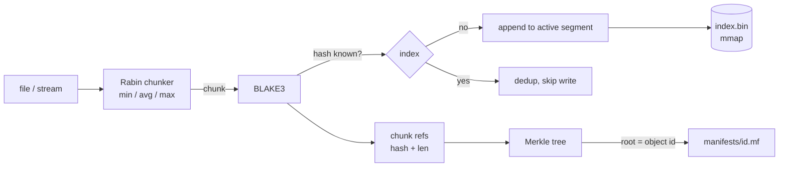
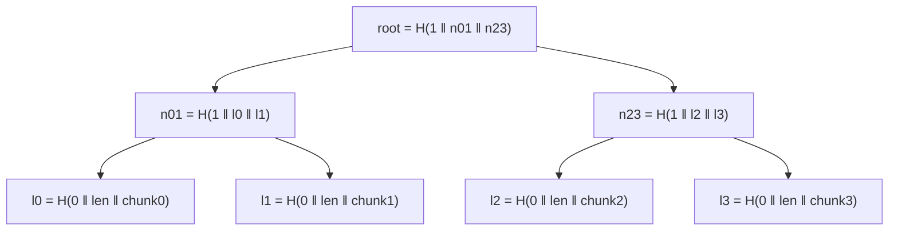

# cas

[](https://github.com/monaaoua9/cas-engine/actions/workflows/ci.yml)

A content-addressed, immutable, deduplicating object store in Rust.

Files are cut into content-defined chunks with a Rabin rolling fingerprint, every chunk is keyed by its BLAKE3 hash, and a file is named by the Merkle root over its chunk list. Chunks live in append-only segment files, found through a memory-mapped hash index. Reference counts plus a compacting GC give the space back when objects are deleted.

Why it is built this way: [docs/DESIGN.md](docs/DESIGN.md).

```
$ cas put backup.tar
3f1c...e9a2                                  # object id = Merkle root
1.2 GiB in 4811 chunks, 412 new (101.3 MiB)

$ cas stats
objects        6
logical size   7.1 GiB
live chunks    6930 (1.4 GiB)
dedup ratio    5.07x
```

## How a file is stored





Leaf and node hashes carry different one-byte prefixes, and an odd node at the end of a level is promoted unchanged rather than duplicated. That rules out the two classic Merkle pitfalls (leaf/node confusion and the duplicate-last-leaf collision). Leaves also bind the chunk length, so the id pins down content, order and sizes.

`cas prove <id> <chunk>` prints an inclusion proof; a verifier needs only the root, the chunk hash and about log2(n) sibling hashes.

## On-disk layout

```
store/
  LOCK                 exclusive file lock, one process at a time
  index.bin            mmap'd open-addressing hash table (rebuildable cache)
  FORMAT               version, and the wrapped master key when encrypted
  segments/seg-N.dat   append-only: [hash 32][len u32][codec u8][payload][sum 8] ...
  manifests/<id>.mf    immutable, written tmp + fsync + rename
```

| Piece | What it is | Source of truth for |
|---|---|---|
| segments | chunk bytes, self-describing records | the data |
| manifests | ordered chunk list + trailer checksum | which chunks belong to which object |
| index.bin | hash -> (segment, offset, len, refcount) | nothing, it is derived |

Because the index is derived, recovery is simple: a header flag records a clean shutdown. If it is missing (crash, deleted file) the store rescans segments (checking every record, truncating a torn tail on the newest segment) and recomputes refcounts from the manifests. A torn write in the middle of an older segment is reported, never silently cut.

Write ordering for `put`: chunk bytes are fsynced, then the manifest is renamed into place, then refcounts are bumped. A crash at any point leaves either nothing visible or a rebuildable store; the index is marked dirty before refcounts can be wrong, so GC never sees undercounted data.

## Garbage collection

Objects are deleted by removing the manifest and decrementing one reference per distinct chunk. Bytes stay in the segment (it is immutable) until `cas gc`, which picks sealed segments whose dead fraction passes `gc_threshold`, copies their live chunks to a fresh segment (verifying each hash on the way), fsyncs, and only then unlinks the old files. A crash mid-GC leaves duplicates, which the next rebuild tolerates.

## Layout of the crate

| Module | Role |
|---|---|
| `chunker` | streaming content-defined chunking over any `Read`: Rabin (GF(2) polynomial tables) or Gear |
| `hash` | 32-byte BLAKE3 digest newtype, hex parse/print |
| `merkle` | tree, inclusion proofs, verification |
| `manifest` | object recipe + binary encoding with checksum |
| `segment` | record layouts (v1, v2), scanning, positional reads |
| `transform` | per-chunk lz4 and encryption, undone on read |
| `crypto` | XChaCha20-Poly1305 sealing, Argon2id key stretching, keyed chunk ids |
| `format` | the FORMAT file: store version and password-wrapped master key |
| `index` | mmap hash table (the only `unsafe` in the crate, one call) |
| `store` | put / get / remove / verify / scrub / gc / stats |
| `tree` | directory listing format (sorted entries, modes, mtimes, symlinks), stored as an ordinary object |
| `snapshot` | named snapshot records and the keep-last / daily / weekly / monthly retention rules |
| `repair` | heal a store from a second copy |
| `metrics` | event counters and Prometheus text |
| `json` | the JSON writer behind `--json` |
| `units` | `64K` / `10GiB` parsing and `human()` |
| `bench` | the `cas bench` timings |
| `backup` | snapshot a directory, restore, diff, verify, forget, prune |
| `main.rs` | `cas` command line |

## Usage

```
cas [-s DIR] put <file>
cas [-s DIR] get <id> <out>
cas [-s DIR] rm <id>
cas [-s DIR] ls
cas [-s DIR] verify [id]       # no id: every manifest and every chunk
cas [-s DIR] prove <id> <n>
cas [-s DIR] gc
cas [-s DIR] stats
cas [-s DIR] check | repair --from OTHER_COPY
cas [-s DIR] metrics
cas bench [--size 64M]
cas [-s DIR] snapshot create <dir> [-n NAME]
cas [-s DIR] snapshot ls | show <name> | verify <name>
cas [-s DIR] snapshot restore <name> <dest>
cas [-s DIR] snapshot diff <a> <b>
cas [-s DIR] snapshot forget <name>
cas [-s DIR] snapshot prune [--keep-last N] [--keep-daily N] [--keep-weekly N] [--keep-monthly N] [--dry-run]
```

As a library:

```rust
use cas::{Store, StoreConfig};

let mut store = Store::open("./data", StoreConfig::default())?;
let put = store.put_file("backup.tar")?;
let bytes = store.read_to_vec(&put.id)?;
store.remove(&put.id)?;
store.gc()?;
```

Defaults (Rabin; `--chunker gear` or `ChunkerConfig { algorithm: Algorithm::Gear, .. }` for Gear): chunks 64 KiB min / 256 KiB avg-step / 1 MiB max, 64 MiB segments, GC threshold 30%. The average step is on top of the minimum, so typical chunks run around 320 KiB.

## Performance

`cargo bench` (criterion, 32 MiB of random data, release build, median of three runs on a Windows laptop, so treat it as a rough floor; ranges and method in [docs/BENCHMARKS.md](docs/BENCHMARKS.md)):

| Benchmark | Throughput |
|---|---|
| Rabin split only | ~168 MiB/s |
| Gear split only (`--chunker gear`) | ~412 MiB/s |
| BLAKE3, one buffer | ~2.3 GiB/s |
| `put`, new data, Rabin | ~178 MiB/s |
| `put`, new data, Gear | ~260 MiB/s |
| `get` with per-chunk hash verification | ~324 MiB/s |

Both algorithms behave the same way (min/avg/max sizes, resync after an insertion, deterministic), so the choice is speed versus tradition: Rabin matches what restic and LBFS do, Gear is about twice as fast here. Data stored with one stays readable under the other; the same bytes chunked by different algorithms simply become two objects that do not share chunks.

Chunking runs on its own thread, so hashing and segment writes overlap with it. This machine is noisy: the same Rabin benchmark has read anywhere from 170 to 380 MiB/s on different runs, so compare ratios inside one table, not numbers across runs. `cargo bench` on your own hardware is the real answer.

The chunker is the bottleneck: each byte depends on the previous fingerprint through a table lookup, so it cannot be vectorised. The window is the input slice itself (no ring buffer) and the first `min_size - 48` bytes of every chunk are skipped, which together doubled its speed.

## Checking, repair, limits, metrics

`cas check` reports what is wrong without touching anything: manifests that fail their checksum, chunks that fail theirs (whether or not an object uses them), and chunks a good manifest lists that the index doesn't have. A store with damage still opens, because opening is what you need in order to fix it; `gc` is the exception and refuses to run while a manifest is unreadable, since chunks only that manifest refers to would look unused.

`cas repair --from OTHER` takes a second copy that shares chunk ids (a copy of the directory, or a replica made by push/pull; an independently created encrypted store has different keys and different ids, so it can't help). Every chunk and manifest it supplies is decoded and re-hashed before it replaces the bad one, then the segments that held bad bytes are rewritten so the damage is off the disk, not just out of the index. Whatever the copy can't supply is listed and left alone.

`--max-size 10GiB` makes writes fail with `store is full` once the segment files would pass that size. Removing objects doesn't free disk until `gc`; `gc` itself is exempt so a full store can always be compacted. Dedup hits write nothing and never fail on quota.

`cas metrics` prints Prometheus text: gauges from the store (objects, live/dead chunks and bytes, disk bytes, quota, dedup ratio) and counters for the current process (puts, chunk reads, corrupt reads, gc runs, quota rejections). The counters are only interesting inside a long-running process such as `cas serve`.

`--json` on any command prints one JSON document on stdout instead of text; exit codes are the same (0 ok, 1 a check or diff found something, 2 error).

`cas bench` times chunking, BLAKE3, put and get on random data in a scratch directory and removes it afterwards; it honours `--chunker`, `--compress` and `--password-file`.

## Compression and encryption

Every v2 record carries a codec byte, so a store can hold a mix and nothing has to be rewritten to change settings.

```
cas --compress lz4 put big.log
cas --password-file pw.txt put secrets.tar      # new store: becomes encrypted
cas --password-file pw.txt passwd --new-password-file new.txt
```

**Compression** is lz4 per chunk, applied only when it saves space (chunks that don't shrink are stored raw). It runs before encryption. `stats` reports sizes on disk, so the dedup ratio includes it.

**Encryption** is XChaCha20-Poly1305 with a random 192-bit nonce per chunk. The chunk id is bound into the ciphertext as associated data, so a chunk can't be replayed under another id. Chunk ids become BLAKE3 keyed hashes: without the key you can't test whether a file you already have is in the store, yet dedup inside the store works as before. A random master key is wrapped by a key stretched from the password with Argon2id (64 MiB, 3 passes by default; the cost is stored in FORMAT). `cas passwd` rewraps 72 bytes and touches no chunk. Manifests and snapshot records are sealed the same way, with their own id or name as associated data, so swapping one file for another is detected.

Encryption is decided when the store is created. A password given for an existing plain store is an error, not a silent no-op, and so is a missing or wrong password for an encrypted one.

**Older stores.** A store without a FORMAT file (written before v2) is opened with the old record layout: it reads and writes as before, and compression and encryption don't apply to it.

## Snapshots

`cas snapshot create <dir>` stores a whole directory. Every file is an ordinary object; every directory is a tree object, a sorted list of `(name, kind, mode, mtime, size, id)` entries stored through the same chunker and manifests as everything else. A directory's id therefore depends only on its contents, so an unchanged subtree has the same id in every snapshot and costs nothing, and `snapshot diff` skips equal ids without descending. A snapshot is a small record in `snapshots/<name>.snap`: the root tree id, the time, the source path, and the list of objects it reaches.

```
store/
  snapshots/<name>.snap   name, time, root tree id, members (id + created flag), checksum
```

Names inside a tree are checked on creation and again on decode: no `/`, `\`, NUL, `.` or `..`, strictly sorted, no duplicates, so a hostile store cannot make `restore` write outside the destination. Restore refuses a destination that is not empty and never writes through an existing path.

Forgetting a snapshot releases only the objects it created. Each member carries a `created` flag, set when the snapshot was the one that added the object (or inherited from an earlier snapshot that did). An object you stored with `cas put` before the snapshot saw it is never removed by a forget. The reverse is a limit: if you `put` bytes identical to something a snapshot created, forgetting that snapshot removes it. Space is returned by `cas gc` as usual.

`prune` keeps the union of the rules: the newest N snapshots, plus the newest snapshot of each of the last N days, ISO weeks (Monday start) and months. An empty policy is an error rather than "delete everything".

Not covered: hard links are stored as separate files, owners and extended attributes are not recorded, sockets and devices are skipped (listed in the create output), and symlinks are restored on Unix only.

## Reading

`open_reader` gives a `Read + Seek` view that decodes one chunk at a time, and `read_range` is built on it. Reads take `&self` and the store is `Sync`, so any number of threads can read the same store; writes and `gc` need `&mut self`, which means a caller who wants both wraps the store in an `RwLock` and `gc` blocks readers while it runs.

## Testing

| Layer | What it checks |
|---|---|
| unit tests | chunk bounds, boundary resync after insertion, fast loop against a ring-buffer reference, Merkle proofs, index against a `HashMap` |
| `tests/store.rs` | round trips, dedup, GC with shared chunks, recovery, bit rot, tampered manifest, lock, streaming reader, concurrent readers |
| `tests/props.rs` (proptest) | random put/remove/gc/reopen sequences against a model; chunker reassembly and read-size independence; manifest and segment parsers on arbitrary bytes; truncated segment is always a clean prefix; tampered Merkle proofs |
| `tests/crash_failpoints.rs` | the binary exits at named points inside put/rm/gc (`cargo test --features failpoints`), then the store must reopen, verify, keep committed data, and gc cleanly |
| `tests/crash_kill.rs` | the binary is killed at arbitrary times during put and gc |
| `fuzz/` | libFuzzer targets for `Manifest::decode`, `segment::scan` and both chunkers (`cargo +nightly fuzz run manifest_decode`); CI runs 60 s per target on every push; a separate `fuzz` workflow runs 30 min per target every Sunday (and on demand) and uploads the crashing input if it finds one |

One failpoint test exists because of a real hazard: a put whose chunks are all already stored changes no index slot until refcounts are bumped, so the dirty flag has to be set before the manifest becomes visible. Removing that line makes `crash_on_dedup_only_put_does_not_lose_data` fail.

## Limits and non-goals

- Single writer per store (file lock).
- Encryption covers chunk contents, manifests, trees and snapshot records. It does not hide the number and sizes of chunks per object, how many objects there are, snapshot names (they are file names), or timing. Keys are not zeroed in memory on drop.
- There is no key file or recovery path: lose the password and the data is gone.
- Directory fsync after rename/unlink is done on Unix; on Windows it is a no-op because there is no equivalent call.
- The crash tests kill the process, not the machine, so they do not cover the OS losing unsynced pages on power failure.
- Chunking is one serial thread by nature; hashing and I/O are a second thread. A single `put` does not scale past two cores.

## Development

```
cargo test --features failpoints
cargo clippy --all-targets --all-features -- -D warnings
cargo bench
```
